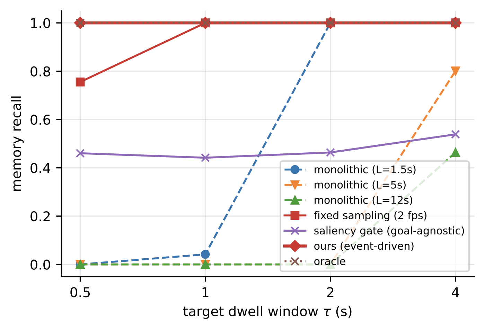
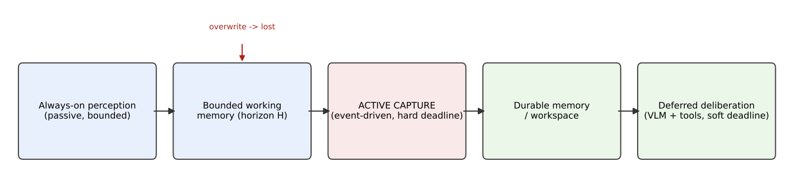

<div align="center">
  <h1>How Should a Camera-First AI Agent Work?</h1>
  <p><sub><code>camera-first-agents</code> · <a href="https://www.chance.vision">Chance AI</a> · arXiv:2610.14772 (v2, 2026-10-10) · 8 pages · 4 figures · 3 tables</sub></p>
  <p><em>Answers can be late; evidence cannot be missed.</em></p>
  <p>
    <a href="https://arxiv.org/abs/2610.14772"></a>
    <a href="https://arxiv.org/abs/2610.14772"></a>
    <a href="main.pdf"></a>
    <a href="LICENSE"></a>
    <a href="code/LICENSE"></a>
    <a href="https://github.com/chancevision/camera-first-agents/actions/workflows/build-pdf.yml"></a>
    <a href="CITATION.cff"></a>
    <a href="https://www.chance.vision"></a>
  </p>
  <p>
    <a href="https://arxiv.org/abs/2610.14772">Paper</a> ·
    <a href="main.pdf">PDF</a> ·
    <a href="#what-the-paper-proposes">What it proposes</a> ·
    <a href="#code">Code</a> ·
    <a href="#citation">BibTeX</a> ·
    <a href="#license">License</a> ·
    <a href="https://github.com/chancevision/tastebench">Companion paper</a>
  </p>
</div>

<table>
  <tr>
    <td width="50%" align="center"></td>
    <td width="50%" align="center"></td>
  </tr>
</table>

<sub><em>Left: the memory and reasoning deadlines that motivate the contract. Right: the two-deadline
architecture — active capture commits a moment before bounded working memory overwrites it.</em></sub>

| | |
|---|---|
| **Authors** | Xiaofan Wu (corresponding), Xi Zeng, Miaoxia Chen, Peishan Chen, Shuyan Li, Chen Wang, Xiaohan Wang, Wanling Xu, Jiyun Yao, Hanyong Zhong, Jiahao Zhu · [Chance AI](https://www.chance.vision) |
| **Status** | arXiv preprint — not peer-reviewed |
| **Categories** | `cs.AI` (primary) · cross-list `cs.HC`, `cs.LO` |
| **Type** | position / contract paper (systems and timing) |
| **Version** | v2 — the source here matches the arXiv e-print |

<a id="what-the-paper-proposes"></a>

## 🔍 What the paper proposes

| Concept | Content |
|---|---|
| **Ephemeral-Target Interaction** | formalizes the setting where a query-relevant visual target appears and disappears within a short window |
| **Perceptual Deadline Contract** | a **hard memory deadline** (commit the moment to durable memory) separated from a **soft reasoning deadline** (produce the answer) |
| **Two-deadline architecture** | always-on bounded non-semantic fast path · *active remembering* before a moment is overwritten · deferred deliberation layer (multimodal model + tools) |
| **Calibration** | baseline latencies come from **measured** frontier-model latency: a short answer takes **1.2–9.3 s**, and an agentic identify-and-search takes longer |

## 📄 What this paper does — and does not — claim

**Does:** reframes camera-first agents around timing rather than recognition; proposes a contract
that separates memory from reasoning deadlines; instantiates it on real track windows as a
consistency check; calibrates the baseline from measured model latency.

**Does not:** report perception or product results. The results are a **labeled scheduler
simulation** — oracle perception over real track windows, with no pixels, no detector, and no VLM
in the loop.

<a id="code"></a>

## 🛠️ Code

Released with the paper — MIT, in [`code/`](code/). The scheduler simulation runs end to end with
no downloads and no API key:

```bash
python code/build_eti_benchmark.py --mock --out out/eti_mock
python code/run_eti_eval.py --episodes out/eti_mock/episodes.jsonl --out out/eti_mock_eval
```

| | |
|---|---|
| [`code/build_eti_benchmark.py`](code/build_eti_benchmark.py) | builds ETI episodes (`--mock` for a synthetic set, `configs/eti_mot.json` for MOT17 track windows) |
| [`code/run_eti_eval.py`](code/run_eti_eval.py) | runs the capture policies (`monolithic`, `fixed_sampling`, `saliency_gate`, budgeted `remember`, `oracle`) and emits the deadline curve, budget and horizon tables |
| [`code/make_figures.py`](code/make_figures.py) | regenerates the four figures from eval artifacts |
| [`code/fetch_mot17.py`](code/fetch_mot17.py) | downloads only MOT17 `gt.txt` — track lifetimes, never pixels |
| [`code/fetch_openrouter_latency.py`](code/fetch_openrouter_latency.py), [`code/measure_vlm_latency.py`](code/measure_vlm_latency.py) | the latency measurement behind the 1.2–9.3 s calibration (needs `OPENROUTER_API_KEY`) |
| [`code/make_attrs.py`](code/make_attrs.py) | attribute/query table (LaSOT variant, `--mock` supported) |

Details in [`code/README.md`](code/README.md).

## 📰 News

- **2026-10-15** — manuscript sources and evaluation code published here; the PDF builds in CI on every push.
- **2026-10-10** — arXiv v2 posted.

## 📦 Contents

```
main.tex      manuscript source (matches the arXiv v2 e-print)
refs.bib      bibliography
main.pdf      compiled from this source
figures/      4 vector figures, generated by our analysis code
assets/       PNG previews of two figures for this page
code/         benchmark builder, policy evaluation, latency measurement (MIT)
```

## 🚀 Build

```bash
latexmk -pdf -interaction=nonstopmode main.tex   # pdflatex + bibtex, as used by arXiv
# or:
tectonic -X compile main.tex
```

CI rebuilds the PDF on every push — see [`.github/workflows/build-pdf.yml`](.github/workflows/build-pdf.yml).

<a id="citation"></a>

## 📚 Citation

```bibtex
@misc{wu2026camera,
  title         = {How Should a Camera-First AI Agent Work?},
  author        = {Wu, Xiaofan and Zeng, Xi and Chen, Miaoxia and Chen, Peishan and Li, Shuyan and Wang, Chen and Wang, Xiaohan and Xu, Wanling and Yao, Jiyun and Zhong, Hanyong and Zhu, Jiahao},
  year          = {2026},
  eprint        = {2610.14772},
  archivePrefix = {arXiv},
  primaryClass  = {cs.AI},
  url           = {https://arxiv.org/abs/2610.14772}
}
```

Machine-readable metadata: [`CITATION.cff`](CITATION.cff) (GitHub's **Cite this repository**).

<a id="license"></a>

## ⚖️ License

- **Manuscript, PDF, figures** — [CC BY 4.0](https://creativecommons.org/licenses/by/4.0/): share and adapt with attribution (cite the arXiv version).
- **Code** (`code/`) — [MIT](code/LICENSE).
- The arXiv record itself remains under [arXiv's non-exclusive license 1.0](https://arxiv.org/licenses/nonexclusive-distrib/1.0/).

**Excluded from both grants:** simulation inputs derived from third-party datasets (e.g. MOT17 track
windows). See [`LICENSING.md`](LICENSING.md); full CC BY text in [`LICENSE`](LICENSE).
